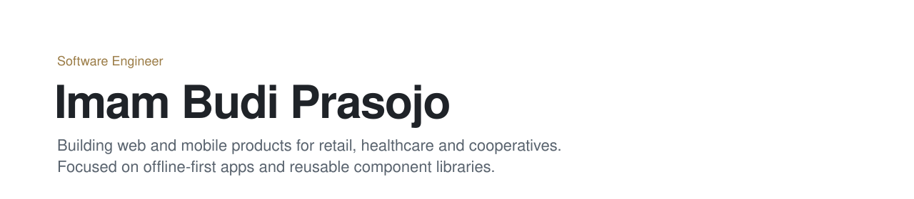
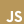
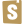
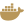

<picture>
  <source media="(prefers-color-scheme: dark)" srcset="assets/header-dark.svg" />
  
</picture>

### Selected work

<b>NusaMedix</b>&ensp;Healthcare · Pharmacy management

 
&emsp;├─&ensp;Point of sale, inventory, purchasing and reporting for pharmacies 
&emsp;├─&ensp;Web client built on an in-house library of 20+ components, documented in Storybook 
&emsp;├─&ensp;Cashier app shipped from one Flutter codebase to Android, iOS, web and desktop 
&emsp;└─&ensp;Vue 3 · Tailwind CSS v4 · Storybook · Flutter · BLoC
  

<b>JojoSuite POS</b>&ensp;Retail · Point of sale

 
&emsp;├─&ensp;Offline-first point of sale for web and mobile 
&emsp;├─&ensp;Transactions continue without a connection and synchronise once it returns 
&emsp;├─&ensp;Receipts print to Bluetooth thermal printers 
&emsp;├─&ensp;Inventory, sales history, reporting and role-based access 
&emsp;└─&ensp;React · TanStack Query · Zustand · Flutter · Riverpod
  

<b>MAIN Koperasi</b>&ensp;Finance · Cooperative management

 
&emsp;├─&ensp;Integrated platform for savings and loans, finance and business units 
&emsp;├─&ensp;Member marketplace and back-office dashboard 
&emsp;├─&ensp;Invitation-based authentication 
&emsp;└─&ensp;Vue 3 · TypeScript · Pinia · Tailwind CSS
  

### Technical skills

<table>
  <tr>
    <td><b>Languages</b></td>
    <td>
      &nbsp;TypeScript&emsp;
      &nbsp;JavaScript&emsp;
      &nbsp;Dart
    </td>
  </tr>
  <tr>
    <td><b>Web</b></td>
    <td>
      &nbsp;Vue 3&emsp;
      &nbsp;React&emsp;
      &nbsp;Pinia&emsp;
      &nbsp;TanStack Query&emsp;
      &nbsp;Tailwind CSS&emsp;
      &nbsp;Vite&emsp;
      &nbsp;Storybook&emsp;
      Zustand
    </td>
  </tr>
  <tr>
    <td><b>Mobile</b></td>
    <td>
      &nbsp;Flutter&emsp;
      BLoC&emsp;Riverpod
    </td>
  </tr>
  <tr>
    <td><b>Data</b></td>
    <td>
      &nbsp;PostgreSQL&emsp;
      &nbsp;Redis
    </td>
  </tr>
  <tr>
    <td><b>Tooling</b></td>
    <td>
      &nbsp;Git&emsp;
      &nbsp;Docker&emsp;
      &nbsp;Figma&emsp;
      &nbsp;Postman
    </td>
  </tr>
</table>

### Contact

&nbsp;[imambprasojo@gmail.com](mailto:imambprasojo@gmail.com)&emsp;
&nbsp;[github.com/ITZjoo](https://github.com/ITZjoo)
